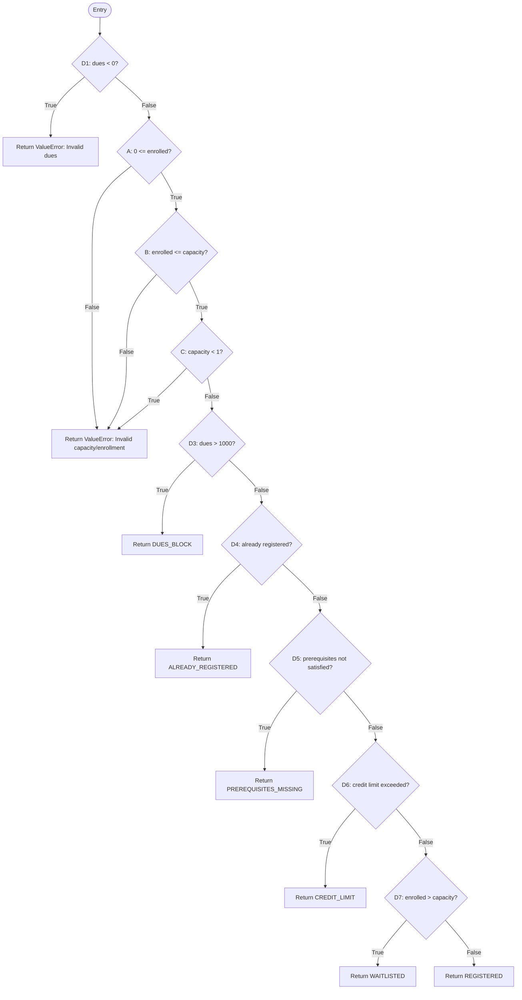

# Part B — White-Box Testing Report

**System under test:** `registration.py`  
**Expected-behavior authority:** `REQUIREMENTS.md` (FR-01–FR-15)  
**White-box tests:** `tests/test_whitebox.py`  
**Coverage tool:** `pytest-cov` with branch measurement

## B1. Control-Flow Graph (CFG) and Cyclomatic Complexity

### CFG for `registration_decision()`

The CFG below includes the two validation exceptions, the five status decisions, and the final registered return. The capacity validation expression is expanded into its three short-circuit atomic comparisons.



### Explicit counting convention and calculation

**Convention:** each atomic Boolean comparison that can independently direct control flow is a predicate node. Thus the short-circuit expression

`not 0 <= course.enrolled <= course.capacity or course.capacity < 1`

is expanded into A (`0 <= enrolled`), B (`enrolled <= capacity`), and C (`capacity < 1`). The chained comparison evaluates B only if A is true; the `or` evaluates C only if the negated chained comparison is false. Calls to `prerequisites_satisfied()` and `check_credit_limit()` are each treated as one Boolean predicate at their call site; their internal CFGs are outside this function's CFG.

- Predicate/decision nodes: 9 (D1, A, B, C, D3, D4, D5, D6, D7).
- Return nodes: 8 (two validation exceptions and six status returns).
- Entry and exit nodes: 2.
- Therefore N = 19.
- Edges: 27 (one entry edge, 18 predicate outcome edges, and 8 return-to-exit edges).

\[V(G)=E-N+2=27-19+2=10\]

The independent check gives **predicate nodes + 1 = 9 + 1 = 10**, matching the edge/node calculation.

If the entire capacity guard were collapsed into one compound CFG predicate, the result would instead be 8. That is not the convention used for the reported CFG because it would hide two short-circuit predicate nodes. The expanded count is used consistently in the basis-path and MC/DC discussion.

### Independent basis path set

| Path | Representative route | Representative test | Notes |
|---|---|---|---|
| P1 | D1 true → invalid-dues exception | Existing black-box invalid-dues test | FR-15 |
| P2 | D1 false, A false → invalid-capacity exception | WB-02 | A short-circuits B and C |
| P3 | D1 false, A true, B false → invalid-capacity exception | WB-03 | B false; C is not evaluated |
| P4 | D1 false, A/B true, C true → invalid-capacity exception | WB-04 | C is evaluated and true |
| P5 | Valid capacity, D3 true → DUES_BLOCK | WB-01 | Rs. 1001 follows implementation's high-dues branch; requirement expects any positive dues to block |
| P6 | D3 false, D4 true → ALREADY_REGISTERED | ECP-10 / DT-04 | FR-05 |
| P7 | D3/D4 false, D5 true → PREREQUISITES_MISSING | ECP-06 / DT-05 | FR-06 |
| P8 | D3–D5 false, D6 true → CREDIT_LIMIT | BVA-02 / DT-06 | FR-07 |
| P9 | D3–D6 false, D7 true → WAITLISTED | No feasible direct test | **Infeasible in the supplied function:** the earlier guard rejects `enrolled > capacity` before D7 can be reached. WB-09 tests `register_course()`'s waitlist-update branch in isolation, not this unreachable decision path. |
| P10 | All preceding decisions false → REGISTERED | ECP-01 / DT-01 | FR-08 |

P1–P8 and P10 have direct representative tests. P9 is retained in the structural basis because its source-level edge exists, but is infeasible under the preceding validation invariant. It must not be falsely reported as executed.

## B2. Statement and Branch Coverage

Coverage was measured on the unmodified `registration.py`; no implementation changes were made. Initial coverage used only `tests/test_blackbox.py`. Final coverage used both black-box and white-box test modules.

| Measurement | Initial: black-box only | Final: black-box + white-box |
|---|---:|---:|
| Statements covered | 54 / 57 (94.74%) | 56 / 57 (98.25%) |
| Branches covered | 23 / 26 (88.46%) | 25 / 26 (96.15%) |
| pytest-cov combined displayed coverage | 93% | 98% |
| Uncovered statements | 51, 59, 71 | 59 |
| Missing branch arcs | 50→51, 58→59, 70→71 | 58→59 |

### Initial gaps and structural additions

- **Line 51 / arc 50→51:** black-box cases used positive dues values below or equal to Rs. 1000. WB-01 uses Rs. 1001 to execute the implementation's `dues > 1000` return. This is structural branch probing, not an endorsement of that threshold: FR-04 says Rs. 1 must block.
- **Line 59 / arc 58→59:** the `WAITLISTED` return in `registration_decision()` is unreachable for ordinary valid inputs. The preceding validation rejects `enrolled > capacity`, while the later condition requires exactly that. This remains uncovered and is reported as an infeasible/dead branch under the supplied input invariant.
- **Line 71 / arc 70→71:** the black-box tests cannot reach `register_course()`'s waitlist append because the decision function does not return `WAITLISTED` for a full course. WB-09 stubs only `registration_decision()` to `WAITLISTED`, isolating the state-update branch. WB-10 covers the already-present student path and confirms no duplicate append.
- **Capacity validation short-circuit paths:** WB-02 through WB-05 exercise A false, B false, C true, and the valid all-false guard outcome.
- **Prerequisite helper paths:** WB-06 through WB-08 cover empty-required, all-present, and none-present outcomes of `prerequisites_satisfied()`.

### Added test IDs and targeted structure

| Added test ID | Targeted branch / condition / path |
|---|---|
| WB-01 | `registration_decision`: dues-block return (line 51) |
| WB-02 | Capacity guard: A false; B and C not evaluated |
| WB-03 | Capacity guard: A true, B false; C not evaluated |
| WB-04 | Capacity guard: A and B true, C true |
| WB-05 | Capacity guard: A and B true, C false; continues registration |
| WB-06 | `prerequisites_satisfied`: `not required` true branch |
| WB-07 | `prerequisites_satisfied`: non-empty required set, helper returns true |
| WB-08 | `prerequisites_satisfied`: non-empty required set, helper returns false |
| WB-09 | `register_course`: WAITLISTED and student absent; append branch executed |
| WB-10 | `register_course`: WAITLISTED and student already present; append suppressed |

**Execution result:** 59 total test instances; 44 passed and 15 failed. All 10 added white-box test instances passed. The 15 failures are the pre-existing black-box requirement-versus-implementation findings from Part A and remain intentionally visible.

## B3. Condition Coverage and MC/DC

`pytest-cov` measures statements and branches; it does **not** directly calculate condition coverage or MC/DC. The following analysis is therefore manual and refers to the source expression and Python's short-circuit evaluation.

### Atomic conditions in `registration_decision()`

| ID | Atomic condition | Test evidence / status |
|---|---|---|
| C1 | `student.outstanding_dues < 0` | Existing invalid-dues test; true and false outcomes exercised |
| A | `0 <= course.enrolled` | WB-02 false; WB-03/WB-04/WB-05 true |
| B | `course.enrolled <= course.capacity` | WB-03 false; WB-04/WB-05 true; not evaluated in WB-02 |
| C | `course.capacity < 1` | WB-04 true; WB-05 false; not evaluated when A or B makes the negated chain true |
| C5 | `student.outstanding_dues > 1000` | WB-01 true; black-box zero/low dues tests exercise false |
| C6 | `course.code in student.registered_courses` | ECP-10 / DT-04 true; normal registration cases false |
| C7 | `not prerequisites_satisfied(...)` | ECP-06 / DT-05 true; WB-07 and successful cases false |
| C8 | `not check_credit_limit(...)` | BVA-02 / DT-06 true; valid credit cases false |
| C9 | `course.enrolled > course.capacity` | False on every reachable valid execution; true is infeasible because the earlier validation rejects it |

### Short-circuit truth/evaluation table for the compound capacity guard

The decision is `not (A and B) or C`, with B evaluated only when A is true, and C evaluated only when the negated chain is false.

| Test | A: `0 <= enrolled` | B: `enrolled <= capacity` | C: `capacity < 1` | Guard result (invalid?) | Explanation |
|---|---|---|---|---|---|
| WB-02: enrolled=-1, capacity=2 | F | NE | NE | True | A false makes the chained comparison false; `or` short-circuits C |
| WB-03: enrolled=3, capacity=2 | T | F | NE | True | B false makes the negated chain true; C is skipped |
| WB-04: enrolled=0, capacity=0 | T | T | T | True | Chain is true, so C is evaluated and makes guard true |
| WB-05: enrolled=0, capacity=2 | T | T | F | False | Chain true and C false; input passes validation |

`NE` means not evaluated, not false. This distinction matters for Python's chained comparisons and `or` short-circuiting.

### MC/DC pairs for the compound guard

Each pair changes one condition's value and changes the overall guard result, while the other conditions are held at non-masking values where execution permits. Under short-circuit evaluation, some values are necessarily not evaluated in one member of a pair.

| Condition independently demonstrated | Test pair | Values and decision effect |
|---|---|---|
| A | WB-05 vs WB-02 | WB-05: A=T, B=T, C=F → guard F. WB-02: A=F, B=NE, C=NE → guard T. A's change alone makes the decision invalid; B/C are masked by short circuit. |
| B | WB-05 vs WB-03 | WB-05: A=T, B=T, C=F → guard F. WB-03: A=T, B=F, C=NE → guard T. A is fixed true; changing B changes the result. |
| C | WB-05 vs WB-04 | WB-05: A=T, B=T, C=F → guard F. WB-04: A=T, B=T, C=T → guard T. A and B are fixed true; changing C changes the result. |

Thus the compound capacity guard has manually demonstrated MC/DC for A, B, and C, with the skipped evaluations explicitly recorded. C9 (`enrolled > capacity`) cannot achieve a true outcome through the public function because of the earlier guard; this is a reachability defect, not a pytest-cov limitation.

## B4. White-Box pytest Implementation

The additional tests are implemented in `tests/test_whitebox.py`. They use assertions and `pytest.raises()` and retain the application implementation unchanged. WB-09 and WB-10 use `monkeypatch` only to isolate the two `register_course()` waitlist branches; this is necessary because the production decision function cannot currently produce a waitlist decision for a valid full course. The tests do not pretend to prove the unreachable `registration_decision()` WAITLISTED return.

Run all tests and collect coverage from the project root:

```bash
python -m pip install -r requirements.txt
python -m pytest -q --cov=registration --cov-branch --cov-report=term-missing tests/test_blackbox.py tests/test_whitebox.py
```

Coverage output and test execution evidence are retained in `PART_B_test_evidence.txt`.
