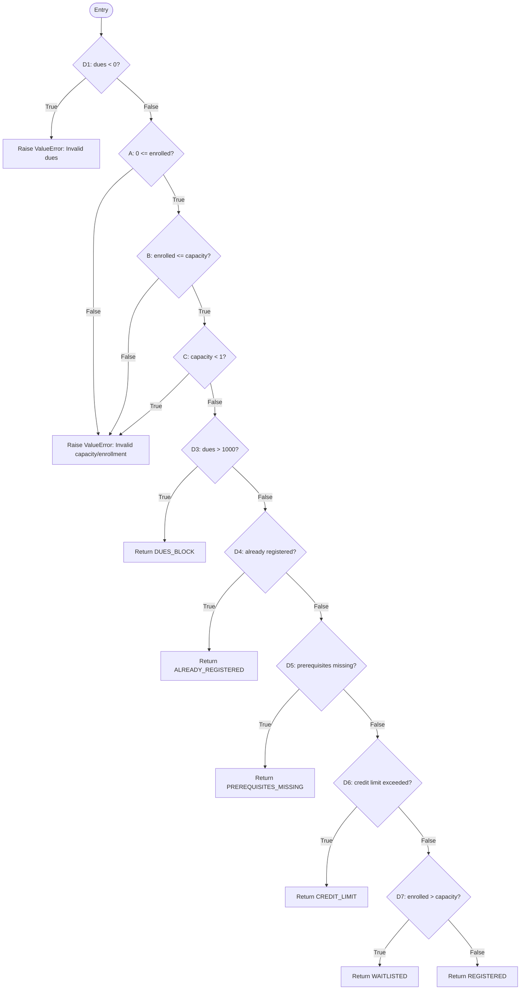

# Part D — Final Testing Report

**System:** Student Course Registration System  
**Course:** SE3002 Software Quality Engineering  
**Requirements authority:** `REQUIREMENTS.md`, FR-01–FR-15  
**Testing artifacts:** `PART_A_REPORT.md`, `PART_B_REPORT.md`, `test_blackbox.py`, `test_whitebox.py`

## D1. Black-box testing summary

### Equivalence Class Partitioning (ECP)

The ECP design partitions the main input dimensions into behaviorally equivalent valid and invalid classes:

- **Outstanding dues (FR-04, FR-15):** zero is valid and does not block registration; any positive amount blocks registration; negative dues are invalid and raise `ValueError("Invalid dues")`.
- **Prerequisites (FR-03, FR-06):** no prerequisites and all prerequisites completed are valid; some or none completed are invalid for registration and produce `PREREQUISITES_MISSING`.
- **Availability (FR-08):** `enrolled < capacity` permits registration for an otherwise eligible student; `enrolled == capacity` produces `WAITLISTED`. Enrollment above capacity is invalid under FR-15.
- **Duplicate registration (FR-05):** a course already present in `registered_courses` produces `ALREADY_REGISTERED`.
- **Course credit hours (FR-02):** 1–4 inclusive is valid; values outside that range raise `ValueError("Invalid course credits")`.

The ECP report defines 12 representative cases, ECP-01 through ECP-12, with requirement traceability and expected outcomes.

### Boundary Value Analysis (BVA)

BVA focuses on values at, immediately below, and immediately above specified limits:

- Current credits: 0 and 18 are valid boundaries; -1 and 19 are invalid.
- Course credits: 1 and 4 are valid endpoints; 0 and 5 are just outside the range.
- Combined credits: totals of 17 and exactly 18 are accepted; a total of 19 is rejected. FR-01 explicitly allows exactly 18.
- Capacity/enrollment: one remaining seat (`enrolled = capacity - 1`) is available; exactly full (`enrolled = capacity`) is waitlisted; enrollment above capacity and capacity below 1 are invalid.
- Dues: zero is non-blocking, while Rs. 1 is the first positive value and must block registration.

The report includes BVA-01 through BVA-16 plus the paired dues boundary check. Expected results are derived from the SRS, not inferred from implementation behavior.

### Decision-table design and priority

The decision table models the FR-09 priority sequence:

1. Positive dues → `DUES_BLOCK`.
2. Otherwise, duplicate registration → `ALREADY_REGISTERED`.
3. Otherwise, missing prerequisite(s) → `PREREQUISITES_MISSING`.
4. Otherwise, exceeding 18 credits → `CREDIT_LIMIT`.
5. Otherwise, no available seat → `WAITLISTED`.
6. Otherwise → `REGISTERED`.

DT-01 through DT-06 exercise every distinct terminal outcome. DT-07 through DT-10 exercise important priority combinations, proving that the first applicable rule determines the result. The decision-only tests also check FR-10 non-mutation.

### Optimization and traceability

The suite uses technique-prefixed pytest IDs (ECP, BVA, DT) so each execution maps back to its test design and requirement. The cross-technique review found **no exact duplicate input scenarios** in the documented suite. Some tests share an outcome or exercise the same requirement using different complete inputs and objectives; matching outputs alone do not make tests duplicates. The dues zero/one BVA pair, for example, uses different student/course fixtures from the ECP representatives.

Parametrization and a single pytest execution consolidate running without erasing technique-to-test traceability. State-transition tests remain separate because they verify mutation behavior, not just decision outcomes.

## D2. White-box analysis: CFG, complexity, paths, and MC/DC

### Control-flow graph for `registration_decision()`

The CFG below uses the explicit convention documented in Part B: each atomic short-circuit predicate is represented as a separate decision node. Calls to `prerequisites_satisfied()` and `check_credit_limit()` are treated as single Boolean decisions at this function's call site; their internal control flow is outside this CFG.

**Node/edge count and cyclomatic complexity**

Using the expanded short-circuit CFG:

- Predicate/decision nodes: 9 (`D1`, `A`, `B`, `C`, `D3`, `D4`, `D5`, `D6`, `D7`).
- Return/exception nodes: 8.
- Entry and exit nodes: 2.
- Total nodes: \(N = 19\).
- Edges: \(E = 27\) (entry edge, two outgoing edges for each of nine predicates, and one edge from each of eight return/exception nodes to exit).

\[
V(G)=E-N+2=27-19+2=\boxed{10}
\]

The independent decision-node check gives \(9+1=\boxed{10}\), in agreement. If the capacity guard were collapsed into one compound predicate, the count would be lower; the report consistently uses the expanded atomic-predicate convention.

### Independent basis paths

A basis set contains ten linearly independent paths under the chosen CFG convention:

| Path | Representative route | Representative test / status |
|---|---|---|
| P1 | Negative dues → invalid-dues exception | Existing FR-15 black-box invalid-dues case |
| P2 | Valid dues; A false → invalid-capacity exception | WB-02 |
| P3 | A true; B false → invalid-capacity exception | WB-03 |
| P4 | A and B true; C true → invalid-capacity exception | WB-04 |
| P5 | Valid capacity; positive-dues decision true → `DUES_BLOCK` | WB-01 |
| P6 | Dues clear; duplicate true → `ALREADY_REGISTERED` | ECP-10 / DT-04 |
| P7 | Earlier checks clear; prerequisite decision true → `PREREQUISITES_MISSING` | ECP-06 / DT-05 |
| P8 | Earlier checks clear; credit decision true → `CREDIT_LIMIT` | BVA-02 / DT-06 |
| P9 | Earlier checks clear; full-course decision → `WAITLISTED` | Infeasible in the original defective implementation; reachable in the corrected CI snapshot |
| P10 | All checks clear → `REGISTERED` | ECP-01 / DT-01 |

P9 needs special interpretation. In the original implementation analyzed in Part B, the capacity validation rejected `enrolled > capacity`, while the later waitlist condition also tested `enrolled > capacity`; that decision return was unreachable for valid inputs. In the corrected CI snapshot now in the project, the condition is `enrolled == capacity`, so the waitlist path is reachable. WB-09/WB-10 isolate the `register_course()` waitlist state-update branch with monkeypatching; they do not, by themselves, prove reachability of the original decision-function return.

### Atomic conditions and MC/DC

`pytest-cov` reports statement and branch coverage; it does not directly measure condition coverage or MC/DC. The MC/DC analysis is therefore manual.

For the compound capacity-validation guard, define:

- A: `0 <= course.enrolled`
- B: `course.enrolled <= course.capacity`
- C: `course.capacity < 1`

The guard is `not (A and B) or C`. Python evaluates B only if A is true, and evaluates C only if the negated chained comparison is false.

| Test | A | B | C | Invalid guard | Short-circuit interpretation |
|---|---:|---:|---:|---:|---|
| WB-02: enrolled=-1, capacity=2 | F | NE | NE | T | A false; B is skipped; left side of `or` is true so C is skipped |
| WB-03: enrolled=3, capacity=2 | T | F | NE | T | A true, B false; C is skipped because left side of `or` is true |
| WB-04: enrolled=0, capacity=0 | T | T | T | T | A and B true; C is evaluated and true |
| WB-05: enrolled=0, capacity=2 | T | T | F | F | A and B true; C is evaluated and false |

`NE` means “not evaluated,” not false.

The independent-effect pairs are:

- **A:** WB-05 (`T,T,F` → guard false) versus WB-02 (`F,NE,NE` → guard true).
- **B:** WB-05 (`T,T,F` → false) versus WB-03 (`T,F,NE` → true).
- **C:** WB-05 (`T,T,F` → false) versus WB-04 (`T,T,T` → true).

Each pair changes the selected condition and changes the overall guard result; short-circuit masking is explicitly shown. Other decision conditions in `registration_decision()` are exercised true and false by the representative ECP, BVA, and DT cases where reachable. The original implementation's `enrolled > capacity` waitlist condition could not be true after validation, so it had no feasible true-condition pair in that version.

## D3. Statement and branch coverage comparison

The primary before/after comparison below is the measured comparison recorded in Part B against the **original, unmodified implementation**.

| Coverage measure | Initial: black-box only | After white-box additions |
|---|---:|---:|
| Statements covered | 54 / 57 | 56 / 57 |
| Statement coverage | 94.74% | 98.25% |
| Branches covered | 23 / 26 | 25 / 26 |
| Branch coverage | 88.46% | 96.15% |
| pytest-cov combined display | 93% | 98% |
| Uncovered statements | 51, 59, 71 | 59 |
| Missing branch arcs | 50→51, 58→59, 70→71 | 58→59 |

White-box additions increased statement coverage by **3.51 percentage points** and branch coverage by **7.69 percentage points** in that original-source comparison. WB-01 covers the high-dues return branch; WB-09/WB-10 isolate the waitlist append and duplicate-suppression branches; WB-02–WB-05 exercise capacity-guard short-circuit paths; WB-06–WB-08 exercise prerequisite helper outcomes.

The remaining line/arc 58→59 in that original version is the unreachable waitlist return described above. This is a reachability issue in the implementation, not a coverage-tool omission.

### Separate later CI snapshot result

The project folder used for the CI workflow contains a later, corrected `registration.py` snapshot. Its retained local CI evidence (`reports/CI_LOCAL_RUN.txt` and `reports/coverage.xml`) records:

- 59 passed, 0 failed.
- 58/58 statements covered (100%).
- 26/26 branches covered (100%).

This later result is **not substituted for** the historical Part B before/after comparison: it is a separate source snapshot in which the relevant decision logic has been corrected. The historical Part A/Part B failure logs remain retained as evidence of the original black-box findings. The local CI run is not evidence that GitHub Actions itself has run; the workflow still needs a push or pull request to execute remotely.

## D4. Overall conclusion

The black-box techniques provide complementary input and behavior coverage: ECP samples valid/invalid classes, BVA probes exact limits and just-outside values, and the decision table verifies every registration outcome and FR-09 priority interactions. The optimization review preserves distinct test objectives while consolidating execution through parametrization and traceable IDs.

The white-box work documents the control flow, a cyclomatic complexity of 10 under an explicit short-circuit convention, ten basis paths, and manual MC/DC pairs for the compound capacity guard. Measured coverage increased from 94.74% to 98.25% statement coverage and from 88.46% to 96.15% branch coverage after white-box additions on the original source. The later CI source snapshot separately achieves 100% statement and branch coverage with 59 passing tests. Both sets of evidence are retained and clearly distinguished.
